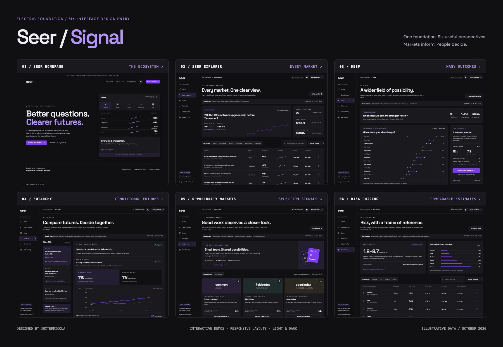

# Seer / Signal

**Six connected interfaces. One shared protocol.**

An interactive design entry for [Seer’s six-interface bounty](https://poidh.xyz/mainnet/bounty/38), created by [@0xterricola](https://x.com/0xterricola). Inspired by Electric Foundation, Signal gives each application a distinct workflow while keeping navigation, typography, controls, and market context consistent.

**[Explore the live demo](https://0xterricola.github.io/seer-signal/)** · **[Design rationale](https://0xterricola.github.io/seer-signal/design/)** · **[Six-screen overview](https://0xterricola.github.io/seer-signal/preview-board.html)**



> This is an independent design prototype. All markets, proposals, protocols, prices, and activity shown are fictional. Transactions are simulated and no funds move.

## The six interfaces

| Interface | Purpose | Live demo |
| --- | --- | --- |
| **Seer homepage** | Introduces the protocol and connects its five applications through an interactive ecosystem preview. | [Visit homepage](https://0xterricola.github.io/seer-signal/) |
| **Seer app / Explorer** | Finds and inspects markets across binary, categorical, scalar, conditional, and independent-selection types. | [Explore markets](https://0xterricola.github.io/seer-signal/explorer/) |
| **Deep** | Compares forecasts across many candidates, including imported agent estimates, with a shared-scale disagreement map. | [Open Deep](https://0xterricola.github.io/seer-signal/deep/) |
| **Futarchy** | Compares the same success measure under proposal-pass and proposal-fail conditions to inform a DAO’s decision. | [Compare futures](https://0xterricola.github.io/seer-signal/futarchy/) |
| **Opportunity Markets** | Helps people inspect submissions and forecast panel selection while leaving the final choice to reviewers. | [Review opportunities](https://0xterricola.github.io/seer-signal/opportunity/) |
| **Risk Pricing** | Compares annualized risk estimates alongside common definitions, liquidity, and market activity. | [Compare risk](https://0xterricola.github.io/seer-signal/risk/) |

## Designed to be used

- **Explore and simulate:** search, filter, sort, save markets, inspect resolution context, and try simulations that preserve each market type’s units.
- **Bring a perspective to Deep:** enter or import scores, load sample forecasts without replacing valid edits, identify disagreements, and review a batch with liquidity context. Valid drafts persist locally and can be exported or cleared.
- **Read conditional forecasts carefully:** switch proposals and compare both futures on the same scale, with interpretation beside the numbers.
- **Review the work behind a price:** inspect distinct opportunity briefs, read the selection rubric, and build a shortlist.
- **Compare like with like:** select two or three risk estimates, inspect their shared measurement basis, and export the table.
- **Use a consistent interface:** shared navigation, light and dark themes, responsive layouts, labelled controls, and keyboard-accessible interactions.

For a guided review, follow the [judge walkthrough](JUDGES-WALKTHROUGH.md).

## Design approach

**Markets inform. People decide.** Forecasts appear beside their units, resolution context, liquidity, and limitations. The layouts change with the task: tables support comparison, cards support submission review, and shared-scale charts support conditional forecasts.

The [Electric Foundation kit](https://www.figma.com/design/cB6ZFMUkBwMBhHadLdiSmh/Seer-Branding?node-id=118-16652) informed the electric violet, layered dark neutrals, and light/dark treatment. Deliberate adaptations include Space Grotesk headings, DM Sans interface text, persistent ecosystem navigation, more whitespace, and restrained activity and liquidity colors. The text wordmark and eye favicon are prototype adaptations, not official exported logo assets.

Read the full [design rationale and EF departures](DESIGN-RATIONALE.md). An alternate [light-theme preview](preview-light.png) is also included.

## Run locally

Clone the repository and start a static server:

```bash
git clone https://github.com/0xterricola/seer-signal.git
cd seer-signal
python3 -m http.server 4173 --directory site
```

Open **http://localhost:4173/**. Serve the files over HTTP rather than opening the HTML directly.

No build step, package installation, environment variables, database, or backend is required.

## Publish updates

The live demo is hosted on GitHub Pages. Source lives on `main`; the contents of `site/` are published to `gh-pages`.

After reviewing your changes locally:

```bash
git add .
git commit -m "Describe your changes"
git push origin main
git subtree push --prefix site origin gh-pages
```

GitHub Pages is configured to deploy from **`gh-pages` → `/ (root)`**. Check the repository’s [Actions](https://github.com/0xterricola/seer-signal/actions) for deployment status, then test the six live links.

For another static host, publish the contents of `site/` with no build command. Keep its directory structure intact. Each route has its own `index.html`, and relative asset paths support hosting under a subdirectory.

## Project structure

```text
site/
  index.html              Homepage
  explorer/               General market explorer
  deep/                   Many-candidate forecast workspace
  futarchy/               Conditional forecast comparison
  opportunity/            Submission review and selection forecasts
  risk/                   Comparable risk estimates
  design/                 Public design notes and credits
  preview-board.html      Fixed-width presentation overview
  assets/
    app.js                Views, fictional fixtures, and interactions
    style.css             Shared tokens, themes, and responsive layouts
    fonts/                Local WOFF2 fonts and their licenses
screenshots/              Six desktop captures
preview.png               Dark-theme presentation board
preview-light.png         Light-theme presentation board
```

The application derives its base path from its script URL. If route folders are renamed, update the route definitions and renderer in `site/assets/app.js`.

## Validation and scope

All six product routes were checked at **320, 390, 768, and 1440 CSS pixels**, with no document-level horizontal overflow in those 24 checks. Review also covered principal demo flows, Deep input validation and persistence, CSV import/export, market context, and light/dark presentation.

These are self-review results, not an independent usability study, formal accessibility certification, or a complete real-device browser matrix. The [validation notes](VALIDATION.md) and [final audit](FINAL-AUDIT.md) describe the checks, corrections, and remaining limits.

The prototype uses native browser APIs, including `dialog`, `localStorage`, and Blob downloads. Watchlists, shortlists, valid Deep drafts, and simulated activity stay in the current browser. Saved demo activity can be reset from **Design notes → Reset saved demo activity**.

There is no live market feed, wallet connection, order execution, or production settlement implementation. Conditional settlement examples and the risk framework are explicitly illustrative. Fonts are bundled locally; the interface makes no external font requests and includes no analytics or API keys.

## Credits and supporting material

- **Entry:** Seer / Signal by [@0xterricola](https://x.com/0xterricola)
- **Brief:** [Design Seer’s six interfaces](https://poidh.xyz/mainnet/bounty/38)
- **Brand reference:** [Electric Foundation / Seer Branding](https://www.figma.com/design/cB6ZFMUkBwMBhHadLdiSmh/Seer-Branding?node-id=118-16652)
- **Typography:** DM Sans and Space Grotesk; bundled font licenses are in [`site/assets/fonts/`](site/assets/fonts/).
- **Review documents:** [Design rationale](DESIGN-RATIONALE.md) · [Judge walkthrough](JUDGES-WALKTHROUGH.md) · [Validation](VALIDATION.md) · [Final audit](FINAL-AUDIT.md)
